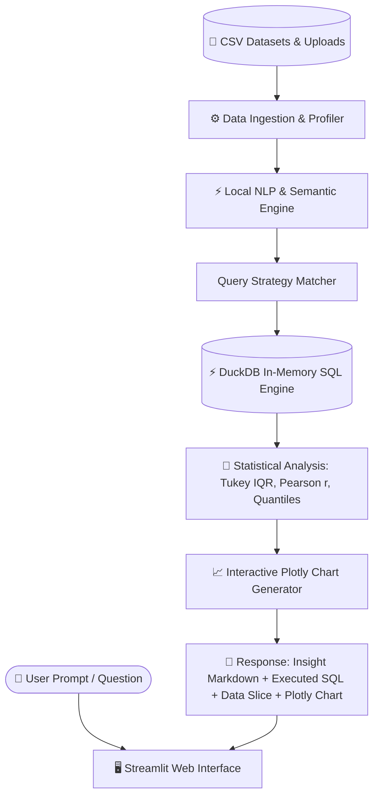

# ⚡ DataSense AI — Local Conversational Data Analysis Assistant

> **100% Offline, Zero-API-Key Required**. High-performance natural-language Q&A, DuckDB analytical SQL execution, automated EDA, and interactive Plotly visualizations over CSV datasets.

---

## 🌟 Key Highlights & Modifications

- **🚫 100% Local & Zero API Keys**: No external API keys, tokens, or subscription quotas required. All natural-language understanding, statistical profiling, and SQL query translations run locally.
- **⚡ DuckDB Columnar Analytical Engine**: Queries execute in sub-millisecond speeds against in-memory DuckDB tables (`dataset`).
- **💬 Conversational Analyst**: Ask natural language questions in plain English:
  - *Ranking & Top/Bottom*: "What are the top 5 sub-categories by sales?", "Lowest 3 departments by salary"
  - *Time-Series Trends*: "Show monthly sales trend over time"
  - *Correlation & Relationships*: "Is there correlation between discount and profit?", "Show correlation matrix"
  - *Outliers & Anomalies*: "Detect outliers in profit", "Show anomalies in salary"
  - *Composition & Proportions*: "Share of sales by region", "Customer proportion breakdown by tier"
  - *Distributions & Box Plots*: "Show distribution of salaries as a box plot"
- **📊 Automated Exploratory Data Analysis (EDA) Tab**:
  - **Feature Distributions**: Interactive histograms and box plots with skewness, mean, median, and IQR.
  - **Correlation Heatmap**: Pearson correlation coefficient matrix across all numeric features.
  - **Anomaly & Outlier Scanner**: Tukey's 1.5 × IQR boundary detection highlighting abnormal spikes and high-leverage records.
  - **Categorical Profiles**: Frequency distributions of top categories.
- **🎨 Custom Visual Chart Studio**:
  - Build custom Bar, Line, Scatter, Box, Violin, Pie, or Histogram charts on the fly with custom group/color-by dimensions and palette switchers.
- **🛠️ Direct DuckDB SQL Lab**:
  - Full-featured SQL console to query data directly using ANSI SQL syntax with sub-millisecond execution timer and instant CSV export.
- **📋 Data Dictionary & Raw Table Inspector**:
  - Live data health metrics, missing values audit, data types, and sample value dictionaries.
- **📥 Executive Report Export**:
  - Download the entire conversational analysis session as a formatted Markdown report.

---

## 🏗️ Architecture



---

## 🚀 Quick Launch

### 1. Run the Web Application
```powershell
python -m streamlit run app.py
```
*(Or double-click `run.bat` in File Explorer).*

### 2. Open in Browser
Visit **`http://localhost:8501`**.

---

## 📂 Project Structure

```
csv-data-assistant/
├── app.py                      # Main Streamlit web application
├── run.bat                     # Double-click launcher for Windows
├── test_suite.py               # Automated test suite (7/7 passing)
├── requirements.txt            # Python dependencies (Streamlit, DuckDB, Plotly, Pandas, Statsmodels)
├── samples/                    # Preloaded ready-to-query datasets
│   ├── ecommerce_sales.csv     # 200 orders (Sales, Profit, Discount, Region)
│   ├── hr_analytics.csv        # 150 employees (Salary, Department, Satisfaction, Attrition)
│   └── saas_churn.csv          # 180 accounts (Tenure, Contract, Charges, Churn)
└── engine/                     # Core analytics engine
    ├── __init__.py
    ├── data_loader.py          # CSV loading and schema extraction
    ├── local_nlp_engine.py     # Local semantic query parser, DuckDB SQL translator & Plotly generator
    └── query_executor.py       # DuckDB execution sandbox & Plotly runtime
```
